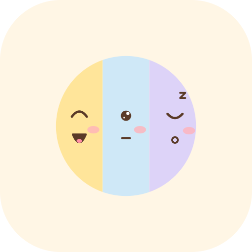
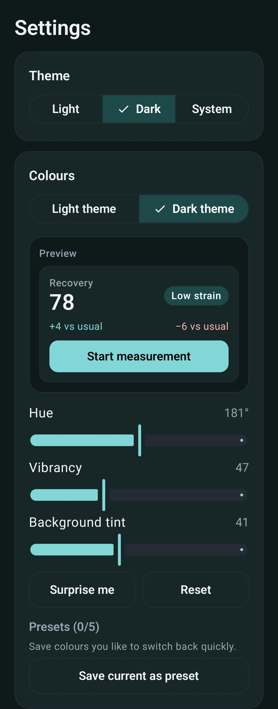
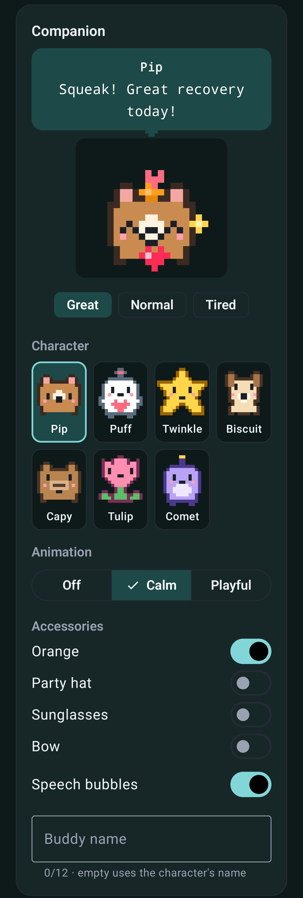
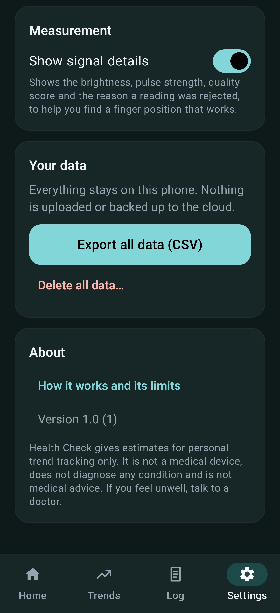
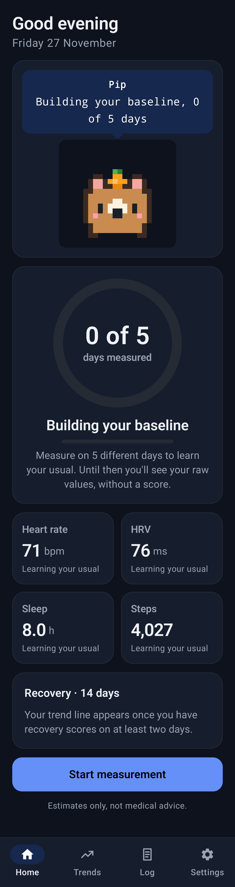
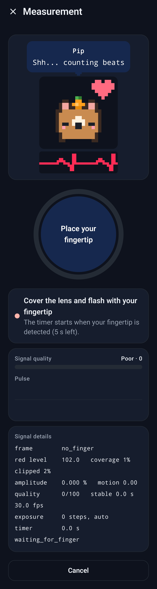
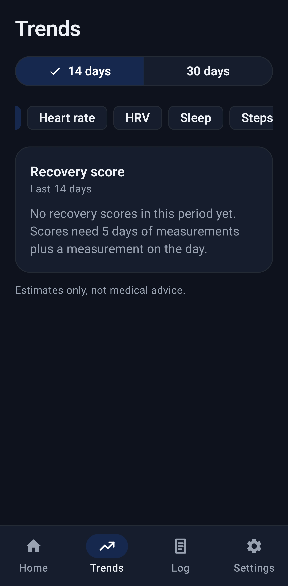

  

<h1 align="center">Health Check</h1>

A private, offline Android app that estimates how recovered or strained you are today. 
Built with Claude Code from my idea and design.

> **Disclaimer:** Health Check is a personal wellness tool, not a medical device. It does not diagnose, treat or monitor any condition, and its readings can be affected by finger placement, lighting and the phone's camera. Don't use it to make medical decisions. If you're worried about your health, speak to a doctor.

## What it does

- **Fingertip pulse reading:** cover the rear camera and flash with your fingertip for 60 seconds. The app uses the camera signal to estimate your heart rate and heart rate variability (HRV).
- **Manual entry:** you type in your steps and sleep. The app never collects data on its own.
- **Personal baseline:** after 5 days of readings, the app compares each day with your own recent history, not with other people.
- **Daily result:** a recovery score from 0 to 100, with a label of Low strain, Normal or Elevated.
- **Trends:** simple charts of your readings over time.
- **Honest about quality:** weak or shaky readings are marked "Lower confidence" instead of being hidden or silently trusted.

## Your companion

A pixel-art character on the home screen reacts to your daily result with its own mood and animation.

- **7 characters:** Pip, Puff, Twinkle, Biscuit, Capy, Tulip and Comet.
- **4 accessories:** hat, orange, sunglasses and bow.
- **Animation levels:** Off, Calm or Playful. It also respects Android's "Remove animations" setting.

## Settings

Everything is configured from the Settings screen, with no account or internet needed.

- **Theme:** switch between light and dark. Each theme keeps its own colours.
- **Colours:** use the hue, vibrancy and background tint sliders for a custom look, or pick a preset. Text switches between black and white automatically, so buttons stay readable on any colour.
- **Companion:** choose your character, an accessory and the animation level (Off, Calm or Playful).
- **Measurement:** an optional "Show signal details" switch that shows live signal quality while you measure.
- **Your data:** export everything to CSV, or delete all data from the phone.

  
  
  

## Screenshots

## Screenshots

  
  
  

## Privacy

- The only permission is **Camera**.
- **No internet access**, no accounts and no analytics.
- All data stays on your phone. You can export it to CSV or delete everything from Settings.

## How this was made

The idea, design and requirements are mine. I did not write the code by hand. It was written by Claude (an AI model from Anthropic) using Claude Code, an AI coding agent, following my instructions and feedback. I directed each step, reviewed the results and tested the app on my own phone.

Because of this, treat the code as AI-generated: review it before relying on it.

## Install

Download the debug APK, allow **Install unknown apps** for the app you open it from, then install it. Turn that setting off again afterwards. Requires Android 10 or newer.

## Build from source

Open the project in Android Studio and run `gradlew assembleDebug`. The APK ends up in `app/build/outputs/apk/debug/`. Run the tests with `gradlew testDebugUnitTest`.
